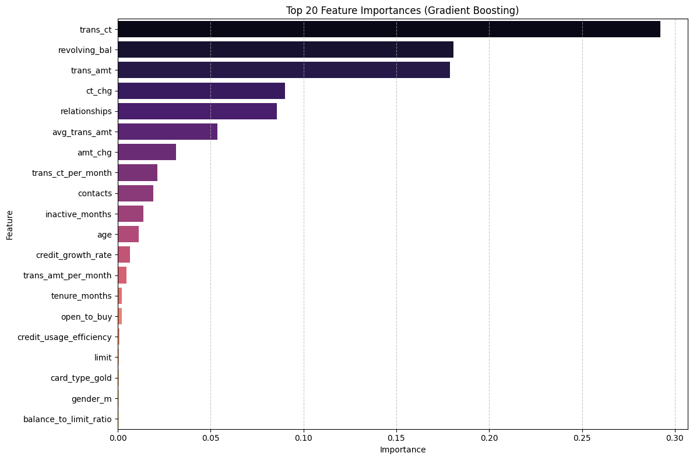
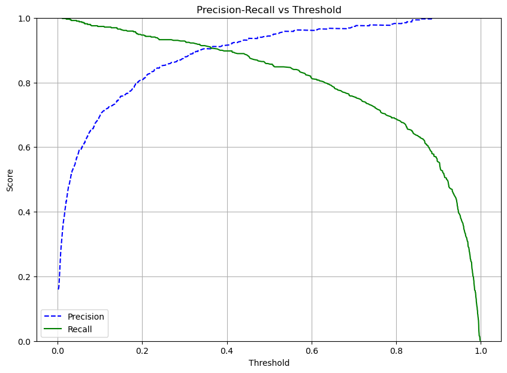
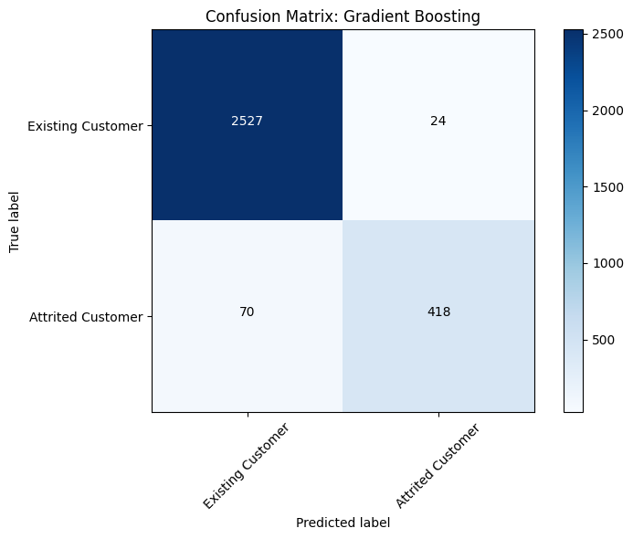
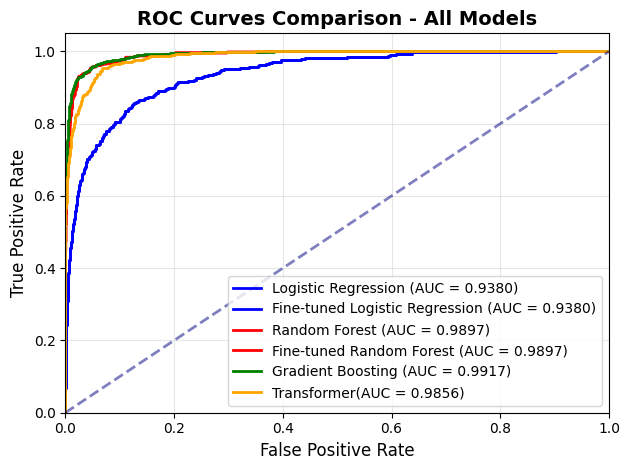

# IS6400 Business Data Analytics — Churn Prediction: Model Insights & Threshold Selection

> **This repository contains only the section I was responsible for within a 6-person group project.**
> The full pipeline (data cleaning, feature engineering, model training and comparison) was a team effort.
> I am publishing my own contribution only, in line with the team's agreement.

**Author:** Mengyang Cao · MSc Business Information Systems, City University of Hong Kong

---

## Context

**Business problem.** A credit card issuer wants to know which customers are about to churn, so that
retention budget can be spent where it actually changes behaviour. The customer base is imbalanced —
only **16%** of accounts had churned — so accuracy alone is a misleading metric.

**Team pipeline (not my part).** The team built the modelling pipeline:

- Cleaned and encoded ~10,000 credit card customer records
- Applied inverse-frequency weighting to address class imbalance
- Engineered behavioural and credit-dynamics features
  (`trans_amt_per_month`, `trans_ct_per_month`, `avg_trans_amt`,
  `balance_to_limit_ratio`, `credit_usage_efficiency`, `credit_growth_rate`)
- Benchmarked four model families — Logistic Regression, Random Forest, Gradient Boosting (GBDT)
  and a Transformer — and selected **GBDT** on validation AUC, accuracy, precision, recall and F1

**My part.** Model insights, threshold selection and deployment. This repository covers that section.

---

## 1. Model Insights — translating feature importances into business drivers

I extracted and ranked the GBDT feature importances, then restated them in business terms rather
than leaving them as a technical output.

**Top drivers of churn:**

| Rank | Feature | Business reading |
|---|---|---|
| 1 | `trans_ct` (transaction count) | **Low transaction frequency is the single strongest churn signal** — disengagement precedes cancellation |
| 2 | `revolving_bal` (revolving balance) | Customers carrying low revolving balances are less financially attached to the card |
| 3 | `trans_amt` (transaction amount) | Falling spend volume tracks with declining engagement |

Features near the bottom (`tenure_months`, `credit_usage_efficiency`, `limit`) contributed little,
which matters for the next step: a GBDT does not need 30+ features to perform well.

I then tested a reduced feature set (top 15 features) and re-ran GBDT on it to check whether
performance held — a 15-feature model is cheaper to maintain and easier to explain to stakeholders
than the full set.

---

## 2. Threshold Selection — the decision that turns probabilities into actions

**This is the core of my contribution.** A churn model outputs a *probability*. To act on it you must
choose a cutoff, and that cutoff is not a modelling decision — it is a **business decision about the
relative cost of two different mistakes**:

- Cut too low → you flag too many loyal customers. Retention offers are wasted, margin is given away
  to people who were never leaving.
- Cut too high → you miss customers who are leaving. Revenue walks out the door.

I analysed this trade-off using the **precision-recall curve** and the **F1-score over the threshold
range**:

**Findings.** Precision and recall are both relatively high in the **0.35–0.45** range; outside that
band, one degrades sharply. The F1-maximising threshold is located by sweeping the curve, and the
team's operating threshold was set at **0.44** — near the top of that band, deliberately favouring
**precision** so that the retention budget is not spent on customers who were not at risk.

**How I framed it for the business:** the threshold is the dial that trades marketing spend against
captured churn, and it should be re-tuned whenever the cost of a retention offer or the value of a
saved customer changes. Reporting a single "best" threshold without that framing is what makes a
churn model unusable in practice.

---

## 3. Deployment — from model output to an actionable list

With the threshold fixed at 0.44, I scored the **entire** customer base and produced a working
customer list for the retention team:

- `predicted_churn_probability` — model score per customer
- `predicted_churn_class` — above/below the 0.44 cutoff
- `is_currently_at_risk` — flagged as high risk **and** not yet churned (the population a retention
  campaign can actually act on)

The output is a ranked list of currently-at-risk customers, sorted by predicted churn probability,
with the original categorical fields re-joined so the business can read it directly (segment,
education, income band, card type) rather than decoding one-hot columns.

**Model quality at this operating point:**

| Metric | Value |
|---|---|
| Accuracy | see notebook output |
| Precision | see notebook output |
| Recall | see notebook output |
| F1-score | see notebook output |
| ROC AUC | see notebook output |

---

## Repository contents

| File | Description |
|---|---|
| `model_insights_threshold_deployment.ipynb` | My section: insights, threshold analysis, deployment |
| `figures/feature_importance_top20.png` | GBDT feature importances |
| `figures/precision_recall_vs_threshold.png` | Precision / Recall / F1 against threshold |
| `figures/confusion_matrix.png` | Confusion matrix at the operating threshold |
| `figures/roc_curve_all_models.png` | ROC curves across models |

**Note on reproducibility.** Cells assume the objects produced by the team's upstream pipeline
(`gb_best`, `X_train_final`, `y_test`, `scaler`, …). The raw dataset is a public Kaggle dataset
(*Credit Card Customers — BankChurners*) and is **not** redistributed here, both for size and because
it is not my material to publish. Output cells have been cleared.

## Tools

Python · pandas · NumPy · scikit-learn · Matplotlib · Seaborn
